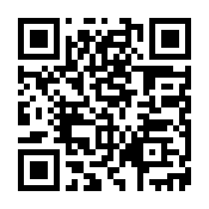

# NFC Participation System – OTH Amberg-Weiden

Students tap their NFC student card when they enter (and leave) a lecture. Lecturers get live attendance,
per-subject participation statistics and an incentive-style grade estimate. Positive reinforcement, not enforcement.

<table>
<tr>
<td><a href="https://nfc-participation.vercel.app"></a></td>
<td>

**Live app:** <https://nfc-participation.vercel.app>
Scan the code with a phone to open it. Access needs an account; locally you can load fictional demo data from *Users & data*.

**Stack:** Python, Flask, Postgres (SQLite locally), Web NFC, PC/SC (USB readers), Vercel.

</td>
</tr>
</table>

## What's in it

| Area | Features |
|---|---|
| **Live sessions** | Start/end a session; roster updates every 2.5 s; big colour + sound + vibration feedback per tap; manual mark/undo; unknown cards link straight to "register this card". |
| **Entry & exit taps** | A second tap after 2 min records leave time and duration. Optional *minimum stay* so tap-and-leave doesn't count. |
| **Scanning options** | ① **Phone** – Web NFC in Chrome on Android (no hardware needed) ② **USB reader** – `bridge/nfc_bridge.py` sends taps to the cloud app ③ **Manual UID** entry. |
| **Dashboard** | KPIs, today's lectures, attendance-by-lecture chart (+ table view), per-subject averages, low-participation list, recent check-ins, calendar. |
| **Students** | Register / edit / re-link cards, CSV import (+ auto-enrol), searchable lists, per-student history. |
| **Student portal** | Students sign in with Moodle ID, see their own participation, missed lectures and grade estimate. First sign-in uses the card UID, then they must set a personal PIN. |
| **Exports** | CSV per lecture and per subject (attendance matrix); spreadsheet-formula injection is neutralised. |
| **Security** | CSRF on every state-changing request, login throttling, hashed passwords/PINs, forced password change for the initial admin, strict CSP + security headers, per-lecturer data isolation, hashed API tokens for readers, UID no longer works as a password once a PIN exists. |
| **Accessibility / UX** | Keyboard navigable, skip link, ARIA live regions, AA contrast, light/dark/system theme, reduced-motion, responsive down to phones, print styles. |

Fixes vs. the prototype: the `/mark` page referenced a missing template (500 error), the nav linked to a route that
didn't exist, the secret key and `admin/admin123` were hard-coded and printed on the login page, statistics ran a query
per student × subject (N+1), future lectures diluted everyone's percentage, and SQLite/USB-reader code could not run on Vercel.

## Run locally

```bash
pip install -r requirements.txt -r requirements-dev.txt
python app.py                      # http://127.0.0.1:5000  (SQLite in ./data)
```
The first start creates the user `admin`. Set `ADMIN_PASSWORD` to choose its password, otherwise a random one is printed
to the console. You must change it at first sign-in. *Users & data → Load demo data* fills in fictional students.

Tests: `python -m pytest` (SQLite). Against Postgres: `TEST_DATABASE_URL=postgresql://... python -m pytest`
(uses an isolated `nfc_test` schema and never touches `public`).

## Deploy (Vercel)

Flask is auto-detected from `app.py`. Required environment variables:

| Variable | Purpose |
|---|---|
| `SECRET_KEY` | signs login cookies (long random string) |
| `DATABASE_URL` | Postgres (the Neon integration sets this automatically) |
| `ADMIN_PASSWORD` | initial admin password (first start only; forced change at first login) |

`vercel.json` pins functions to `fra1` (next to the Neon database in Frankfurt). Without `DATABASE_URL` the app falls
back to a temporary SQLite file in `/tmp`, which Vercel wipes regularly – use it for demos only.

## Using a USB reader (ACR122U etc.)

1. In the web app: **Account → Reader bridge → Create token** (shown once).
2. On the laptop with the reader: `pip install pyscard` then
   `python bridge/nfc_bridge.py --server https://nfc-participation.vercel.app --token nfcp_...`
3. Start a session in the browser. Every tap goes into *your* open session – no lecture ID needed.
   Taps while no session is open are kept so the *Scan card* button on the Students page can pick them up.

`--simulate` lets you type UIDs instead (for testing without hardware).

## Bringing over data from the old prototype

```bash
python scripts/import_legacy.py "path/to/old/students.db"                    # local SQLite
DATABASE_URL="postgresql://..." python scripts/import_legacy.py students.db   # the cloud database
```
Read-only on the old file, safe to re-run. Check data-protection rules before uploading real student data.

## Layout

```
app.py                  Vercel / WSGI entrypoint
participation/          Flask app (db.py, services.py, security.py, views/, templates/)
public/static/          CSS, JS, logos (served by Vercel's CDN)
bridge/nfc_bridge.py    USB reader -> web app
scripts/import_legacy.py
tests/                  22 tests (SQLite and Postgres)
```

## Notes & limits

* Web NFC works only in Chrome on Android over HTTPS; iPhones need the bridge or manual entry.
* A card UID is not a secret and can be cloned – treat attendance as an incentive signal, not proof.
* The grade estimate (≥90 → 1.0, ≥80 → 2.0, ≥65 → 3.0, ≥50 → 4.0, else 5.0) mirrors the prototype; adjust `GRADE_STEPS` in `participation/__init__.py`.

## Related projects

[Citrus](https://github.com/nightsharkux/Citrus) (the wider classroom platform, which also has NFC check-in), [Folio](https://github.com/nightsharkux/folio), [Yris](https://github.com/nightsharkux/yris).

*An independent student project, not an official OTH Amberg-Weiden service. The data in the demo is fictional.*
